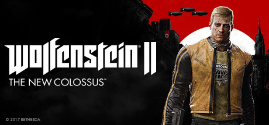

**Wolfenstein II: The New Colossus is BJ Blazkowicz's brutal return, fighting to liberate America from Nazi occupation in one of gaming's most politically charged and violently satisfying FPS campaigns. Features dual-wielding, stealth, and relentless combat pacing.**

---

## 📖 About

Wolfenstein II: The New Colossus is BJ Blazkowicz's brutal return, fighting to liberate America from Nazi occupation in one of gaming's most politically charged and violently satisfying FPS campaigns. Features dual-wielding, stealth, and relentless combat pacing.

## ⚠️ Problems Without Trainer

| Problem | Status |
|---------|--------|
| **Mein Leben Mode** — One-life permadeath challenge is one of gaming's hardest achievements | ✅ Solved |
| **Resource Scarcity on Uber** — Armor and health rarely spawn on highest difficulty | ✅ Solved |
| **Elite Enemy Variants** — Super Soldiers and Panzerhunds require specific takedown approaches | ✅ Solved |
| **Missable Enigma Codes** — Missing codes locks out secret enemy encounter on current playthrough | ✅ Solved |

## ✅ Solution

The **Wolfenstein II: The New Colossus Trainer** solves all these issues by giving you complete control over the game.

## 🎯 Full Feature List

- Unlimited Resources
- God Mode / Invincibility
- Instant Skill Cooldown
- One-Hit Kill
- Freeze Game Timer
- Unlock All Items & Achievements
- Custom Speed Multiplier
- Save State Anywhere

## 🚀 Quick Start

1. **Disable Windows Defender** temporarily (trainer may trigger false positive)
2. Download the trainer from the button above
3. Launch Wolfenstein II: The New Colossus
4. Run the trainer as Administrator
5. Activate desired cheats with hotkeys

## 💎 Free vs Paid

| Feature | Free | Pro |
|---------|------|-----|
| Basic God Mode | ✅ | ✅ |
| Unlimited Resources | ✅ | ✅ |
| All Advanced Cheats | ❌ | ✅ |
| Auto-Updates | ❌ | ✅ |
| Priority Support | ❌ | ✅ |

## 💻 Requirements

- Windows 10/11 (64-bit)
- Wolfenstein II: The New Colossus (any version)
- .NET Framework 4.8+
- DirectX 11+

## 🍎 macOS

macOS users can use our alternative tool:

## ⚖️ Legal

This trainer is for educational and single-player use only. Use responsibly.

---

